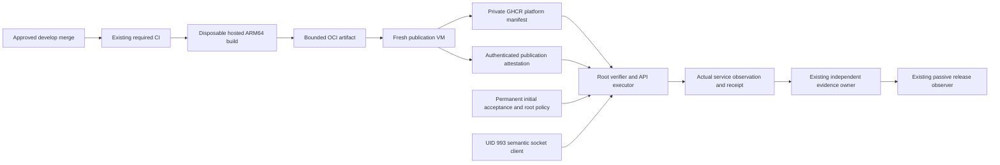

# M4 backend artifact delivery and API execution V2

Source candidate, 2026-10-14. Status: **IMPLEMENTED_AND_TESTED_SOURCE**;
**REVIEW_PENDING**, **NOT_INSTALLED**, **LIVE_ACCEPTANCE_PENDING**.
Tests establish source behavior with synthetic providers. No operational automatic
pipeline, registry publication, host transition or environment release is claimed.

This extends [restricted boundary V1](MONEYBOWL_M4_RESTRICTED_EXECUTION_BOUNDARY_V1.md).
V1's offline CLI remains a compatibility model and cannot deploy. The new V2
production entrypoint has a callable success path; it is gated by independently
installed root policy. The previous host-Engine build guard remains intact.

## Starting point and preserved owners

Worktree: `/home/ubuntu/moneybowl-worktrees/m4-dev-execution-boundary-v1`;
branch: `feature/m4-dev-execution-boundary-v1`; starting HEAD:
`bd5b0084df5d8cfdf7a824fd3a0485aa1a9f6f95`. Host identification returned
`moneybowl-ingestion-dev-vnic`, Linux ARM64. Worktree was clean. Canonical develop,
local origin/develop and independently read GitHub develop matched
`4833842510940586621e0d28dc7448aa2c4079ff`; the remote feature ref matched the starting
HEAD. Shell DNS to GitHub was unavailable; the read-only GitHub connector supplied
remote Git refs. No ref was fetched, moved or reset in the implementation checkout.

The sealed `4833842...` controller, canonical checkout, protected preview, original
env, recovery/Caddy history, empty root approval/staging parents and installed
services were untouched. Supplied Flutter acceptance remains owned by the existing
Flutter owner. Supabase's existing GitHub integration remains its deploy owner.
The API's legacy ancestry remains UNKNOWN until separately authorized initial
acceptance. No QA, main, Production, financial dispatcher or second webhook owner
is added.

The permanent initial tuple retains these exact identities:

- Image: `ghcr.io/sharanravi954mf/moneybowl-ingestion-dev@sha256:257c0fd51f3d47a8d24031fd90333945c804a159ad6779301226edcd3fc80945`
- Build source: `8afa04f9db4a3429fdfeef503d4ebaf6abf18aa5`
- Component: `5f06254a13cb666449336425b1a66d31fa8db4afbb30d78d0bc7687dd67d5fd5`

## Artifact and execution path



[environment-promotion.yml](../../.github/workflows/environment-promotion.yml)
preserves the existing contracts/Flutter/backend/required-CI jobs and passive
release job. Two additional fresh jobs require successful `validated`, the exact
same-repository non-fork develop push, and owner variable
`M4_IMAGE_PUBLICATION_ENABLED=owner-approved-v1`. That variable was NOT set.
No dispatch, PR, pull_request_target, QA or main publication path exists.

The build VM is `ubuntu-24.04-arm`, supported in public and private repositories
by [official runner guidance](https://docs.github.com/en/actions/reference/runners/github-hosted-runners)
and the [January 2026 runner announcement](https://github.blog/changelog/2026-01-29-arm64-standard-runners-are-now-available-in-private-repositories/).
Checkout is exact SHA with credentials not persisted. Only its Git-exported service
context is sent to BuildKit. A checksum-pinned ARM64 BuildKit runs on the disposable
GitHub VM, with empty process environment, no insecure entitlements, and bounded
job/build duration. Proposed hosted-VM `sudo` starts this disposable builder only;
it grants no Oracle capability and was not executed by this task. There is no
Docker/SSH socket, Oracle mount/env, runtime token or Supabase credential in the
build. Job permission is only `contents: read`; no package writes, attestation
writes or OIDC. The VM's GitHub read/upload capability is not an Oracle credential.
Runner VM resources/disk and a 25-minute job limit bound the build; output above
512 MiB is rejected. This does not claim Dockerfile safety or reproducibility.

The publisher never checks out repository code or runs an image/build hook.
[oci_delivery.py](../../tools/deployment/oci_delivery.py) is a standalone program
embedded byte-for-byte in the reviewed workflow; a regression enforces equality.
It consumes one uncompressed OCI tar, rejects unsafe/duplicate names, symlinks,
hardlinks, devices, sparse/extended entries, unreferenced blobs, external descriptor
URLs, malformed JSON/descriptors, oversized content, wrong platform/runtime or
source metadata, and verifies every blob's SHA-256. Layer tar structure and total decompressed
content are stream-checked with a 2 GiB expansion limit and 50,000-file limit, without extracting layers
or following their normal container-filesystem symlinks on the publisher host. It independently computes the
component digest from GitHub's exact tree and authenticates the run/attempt and CI/
build jobs. Labels corroborate this workflow's source recipe; labels alone never
provide admission authority.

The root OCI index digest identifies the exported archive's index. The selected
ARM64 platform manifest digest identifies the published image, and the config
digest identifies its OCI configuration. These three are separately retained and
tested. The publisher uploads verified blobs and the platform manifest via fixed
GHCR REST endpoints, then checks manifest bytes by digest. It writes no mutable
image tag, does not repack layers or run registry-provided code, strips redirects,
and never forwards package authority to an arbitrary URL. Each new release SHA
builds a new image with truthful build-source and release-source labels. Component
reuse never relabels a historical image.

Before requesting a credentialed GHCR pull/push token, publication checks the
exact manifest using the standard anonymous pull challenge. Realm, service and
repository pull scope must match fixed GHCR policy; no challenge URL is followed.
An anonymous bearer token that reads the manifest rejects publication, even when
the initial request returned 401. Separately, authenticated read-only
[package metadata](https://docs.github.com/en/rest/packages/packages#get-a-package-for-a-user)
must identify the fixed existing container package and explicitly report PRIVATE.
This package-scope evidence is required even when a new SHA's manifest returns
404. Unknown challenges, responses, missing metadata or other visibility fail
closed before upload authority. Anonymous probes receive no owner credentials;
no package visibility change or new credential is introduced. Commissioning must
prove that the existing publisher token can read this package metadata.

## Permission and disclosure review

This is an explicit proposed change from the prior read-only Actions policy.
Existing CI/release permissions are unchanged. Only the gated publisher proposes:

| Job permission | Purpose and limit |
| --- | --- |
| `contents: read` | Exact repository/tree and source identity reads |
| `actions: read` | Authenticate the run, attempt, CI and build job results |
| `packages: write` | Publish the fixed existing GHCR DEV package with GITHUB_TOKEN |
| `attestations: write` | Store the signed publication attestation with GitHub |
| `id-token: write` | Obtain the GitHub OIDC identity for the attestation action |

No personal token, Oracle credential, financial token or Supabase writer enters
Actions. Package visibility is never changed; anonymous image access must fail.
The owner must independently verify existing PRIVATE package identity, repository
Actions access and whether the repository's token can write additional linked
packages. `packages: write` is provider-scoped permission, not a cryptographic
single-package sandbox. The reviewed publisher uses one fixed package; reducing
provider-side package access is separate authorization, not an assumption here.

`actions/attest` signs the platform manifest subject with a custom publication
predicate, binding source/component, repository, workflow, event/ref, run/attempt,
archive/index/platform/config digests and hosted builder identity. This truthfully
attests validated publication from the isolated build job; it does not pretend the
credentialed publisher compiled the image or claim SLSA Level 3.

For this PUBLIC source repository, GitHub uses Sigstore's public-good instance;
the bundle enters a publicly readable transparency log even though the GHCR package
stays PRIVATE. Package name/digests, source/component identity, workflow, run/attempt
and recipe metadata can therefore become public. No secrets, env values, protected
paths, service observations or private host policy appear in the predicate. The
owner must approve that specific metadata disclosure before enabling the gate.
[GitHub documents these visibility differences](https://docs.github.com/en/actions/concepts/security/artifact-attestations).
If disclosure is unacceptable, leave this gate off. The smallest alternative is a
separately reviewed private provenance repository with an eligible Enterprise Cloud
attestation plan, changed exact signer policy and additional identity/access review;
no unsigned JSON fallback is authorized.

New pins verified through official GitHub ref/asset metadata on 2026-10-14:

| Dependency | Immutable revision/content pin |
| --- | --- |
| actions/checkout v6 | `d23441a48e516b6c34aea4fa41551a30e30af803` |
| actions/upload-artifact v6 | `b7c566a772e6b6bfb58ed0dc250532a479d7789f` |
| actions/download-artifact v6 | `018cc2cf5baa6db3ef3c5f8a56943fffe632ef53` |
| actions/attest v4 | `1e69f48acb82d1966a394da916b4c1698aa569d6` |
| BuildKit v0.34.0 ARM64 release tar | `sha256:0619ca3e3205a32ea2beb115e0242136e4a0716cc1917ba0ceaa4ef4d52382c9` |
| gh v2.102.0 ARM64 release tar, later installation prerequisite | `sha256:7862c86c72f43df3a2d93ddde6f473285b4e2af61b494849846827e513ef6484` |

Primary references: [attest action and inputs](https://github.com/actions/attest/blob/1e69f48acb82d1966a394da916b4c1698aa569d6/action.yml),
[artifact upload](https://github.com/actions/upload-artifact/tree/b7c566a772e6b6bfb58ed0dc250532a479d7789f),
[artifact download](https://github.com/actions/download-artifact/tree/018cc2cf5baa6db3ef3c5f8a56943fffe632ef53),
[BuildKit release](https://github.com/moby/buildkit/releases/tag/v0.34.0),
[CLI release](https://github.com/cli/cli/releases/tag/v2.102.0).
GitHub maintains hosted OS images; the runner image itself is not an immutable
machine digest. Oracle executables additionally require approved installed binary
hashes/inodes. Missing tools or unsupported interfaces fail closed.

## Runtime interfaces and root authority

[api_broker.py](../../tools/deployment/api_broker.py) exposes `serve` and
`request --revision <40-hex-SHA>`. A separately sealed bootstrap must invoke its
`main()` with isolated Python `-I -B`, installed module path and sanitized environment.
For example, after a separately authorized installation, a root:root systemd unit
can use this exact bootstrap shape with the reviewed SHA substituted once:

```sh
/usr/bin/python3 -I -B -c 'import sys; sys.path.insert(0,"/opt/moneybowl-deployment/REVIEWED_SOURCE_SHA/tools/deployment"); import api_broker; raise SystemExit(api_broker.main())' serve
```

The UID 993 owner's independently installed bootstrap uses the same reviewed module
closure and `request --revision <SHA>`, or the existing ingestion CLI's V2 routing.
Root-owned version directories must permit code traversal, and reviewed code/JSON
policy constants may be root:root `0444` so UID 993 can import the client. Their
inode/content seals remain mandatory. Root code may also remain `0400` in a separate
server-only closure. Actual root policy/config/credentials/state remain private
`0400`/`0600` with protected ancestry; public-code reading is restricted to the
fixed installed code closure, never a generic permission exception.

The server has no config/path/executable option: it reads only
`/etc/moneybowl-deployment/api-executor-v2.json`. The
[disabled example](../../tools/deployment/api-executor-v2.example.json) is a shape
reference, not approved policy. Neither flag nor directory existence enables it.
The existing ingestion owner selects the socket client only when its separately
commissioned DEV config explicitly has `execution_boundary: api-executor-v2`.
The former privileged build path is not selected.

UID/GID 993/983 can submit exactly `schema_version: 2`,
`operation: reconcile-api-v2`, `git_commit` and a nonzero 64-hex `request_id`.
It cannot select image, argv, endpoint, project, target, path, env, mount, Compose
file or build context. The fixed root-owned Unix SEQPACKET socket is
`/run/moneybowl-api-executor/reconcile.sock`. Its directory is root:983 `0750`,
socket root:983 `0660`; no ACL. A root-owned read-only commissioning marker controls
the client before socket contact. Requests/replies are bounded to 1 KiB. Kernel
SO_PEERCRED must identify a positive PID with UID/GID 993/983. Host user/PID namespace,
zero effective capabilities and the fixed ingestion systemd cgroup are checked
before receiving. FD/control-message transfer and truncation are rejected; received
FDs are closed. Receive/send timeouts, one active worker, nonblocking deployment
lock and a 240-second worker process-group deadline bound concurrency and execution.

These assumptions require host user/PID namespaces and cgroup v2. SO_PEERCRED does
not identify an executable: commissioning must prevent UID 993 from creating/joining
the approved cgroup or delegating its socket capability. Root installation must use
a sealed owner program and audited unit, no delegate-controlled service configuration.
The root executor's only capability is its reviewed code interface; UID 993 gets no
Engine socket/group/ACL, sudo, root config, private state, registry auth or secrets.

[delivery_verifier.py](../../tools/deployment/delivery_verifier.py) independently
resolves current develop from authenticated GitHub API state, requires a merged
same-repository feature PR at that exact merge SHA, and an approved review on the
PR head from a root-approved login plus numeric reviewer ID. Changes-requested
reviews, incomplete result pages, wrong event/ref/workflow/SHA/attempt/fork/repository
ID, missing successful CI/build/publish jobs or ambiguous publication fail. Overall
workflow success is not required: the passive release observer can properly fail
while backend publication succeeded and other evidence is still uncommissioned.
Only the required CI and new publication jobs authorize the artifact. The verifier
can progress once those jobs finish while the passive observer is still running,
avoiding a circular wait between deployment and consolidated release evidence.

A pinned `gh attestation verify` authenticates the actual immutable OCI subject
using supported trust roots, exact repository/workflow/certificate issuer and identity,
signer/source SHA, develop ref, hosted runner and custom predicate type. The
verified statement is then checked against the independent run/attempt/source and
private registry bytes. [The CLI documents these supported flags and verified JSON](https://cli.github.com/manual/gh_attestation_verify).
A label, JSON file or successful mocked command never authorizes production.
The actual host CLI observed here is **gh 2.45.0**, which rejects `attestation` as an
unknown command. It was not upgraded. A supported, reviewed binary and its trust
root/network/auth behavior are therefore exact external prerequisites.

The root-controlled bare source mirror rejects writable/link/ACL ancestry,
shallow/grafted/alternate sources and unsafe Git configuration. Fixed HTTPS fetch,
pinned Git, disabled hooks/helpers/fsmonitor/replace objects/auto-maintenance,
initial ancestry, and exact infrastructure/workflow byte pins preserve source
policy. Changes to workflow, Compose, Caddy, installed controller, protected inputs
or runtime policy need independent human policy authorization. Application releases
under that unchanged policy need no recurring root ticket or Termius session.

[api_executor.py](../../tools/deployment/api_executor.py) rechecks root-owned code,
config, initial-authority and runtime seals by approved device/inode/UID/GID/mode,
content digest, ACL/ancestry, checked descriptors and before/after pathname identity.
It validates the permanent original plan/journal/verification/receipt/provenance
and consumed initial authorization, retaining the original acceptance helper.
State and `.owner.lock` remain root-controlled and shared with the original initial
controller; the old proposed UID 993 state handoff must NOT be used for V2.

Runtime is an independently approved, private API-only JSON snapshot, not checkout
Compose. It contains the fixed worker/user/security/limits/healthcheck, zero host ports,
exact reviewed environment and existing external resources. Source binds, hooks,
builds, dependencies, secret/config-file passthrough and extra services are rejected.
The generated release snapshot changes only digest and release labels. Literal
secret dollars are escaped, no inherited interpolation input is used, and the JSON
is held in a write/grow/shrink-sealed memfd. Compose opens `/proc/<worker-pid>/fd/N`
while that descriptor remains held; this avoids both pathname substitution and
Go plugin FD-inheritance assumptions. Planned API network names/IDs, effective
Compose aliases and named-volume targets/write modes must match the measured
current API before mutation. The approved hosted override already resets API
ports to an empty list: Caddy reaches it through its private network. Both sealed
model and runtime observations forbid host bindings, including loopback bindings.
Use empty extra alias lists when the initial service uses Compose defaults; adding
an explicit duplicate `api` alias would change the measured relationship. No active
source mount is silently rewritten.
Any required mount relocation/sealing is separate human infrastructure work. Every
static file bind must be covered by approved protected-input policy or a root file
relationship seal; writable-ancestry static mounts block commissioning. Directory
asset mounts remain owned by the existing frontend mechanism and are separately
measured by the independent evidence owner. Registry credential inode/content seals
are also mandatory; secret rotation is a separate authorized policy change.

Only `docker image pull --platform linux/arm64 <verified-digest>` and
`docker compose ... up --detach --no-deps --no-build --pull never --scale api=1
--wait --wait-timeout 120 api` can mutate Engine state. The root policy pins daemon,
Docker/Compose/systemctl/Git/gh executables and relationships. Docker access remains
inside the root adapter. Systemctl is used only to read retirement state. There is
no exec, build, cleanup, restart, resource creation, dispatcher or unrelated-service
mutation operation.

Actual observations project non-secret container fields, image and source identities,
one non-root worker/process, security/mounts/relationships/limits, health/public
readiness, all five unrelated IDs/images/runtime fingerprints, complete project
inventory, disk/inode reserves and Docker storage binding, existing network/volume
identities, protected input relationships and
stopped/masked/disabled dispatcher container/units/timer. Actual API environment
values are compared privately in root memory to the sealed snapshot, and are never
copied into journals, exceptions, reports or receipts. First activation must match
permanent initial acceptance; later activations must match the latest consumed
transaction. Unexpected labelled images are not accepted merely through ancestry.

## Durable transaction and independent evidence

Before pull or activation the broker publishes/fsyncs immutable intent consuming
proof/run/attempt/digest identity, release SHA and request nonce. It rechecks source,
policy, initial tuple and observations immediately before one activation attempt.
After the potentially long pull and image inspection, the Engine invokes a fixed
root-broker guard immediately before the sole Compose up. That guard rechecks
root authority, unchanged observations, exact reviewed source/run/attempt and
proof freshness, ending with a fresh authenticated develop HEAD and expiry check.
Supersession or expiry during pull produces zero Compose activations; because
pull has consumed a durable transaction, it remains quarantined without retries.
Sequence numbers preserve ordering. It then independently observes, rechecks source/
proof/authority, archives observations, publishes a sanitized timestamped service
receipt and finally archives completion. Any crash, timeout, uncertain Engine delivery,
partial publication, post-attempt branch movement or drift leaves an incomplete
transaction and quarantines all future requests, including different nonces.
There is no automatic rollback, blind retry, reset or recovery endpoint.
Only genuine pre-attempt supersession may return `superseded`.

Duplicate/restarted requests cannot activate again. They authenticate the retained
publication again, measure the current service, and renew the sanitized receipt.
The original immutable completed intent supplies the exact image/run/attempt
locator after the 30-day Actions identity artifact expires or disappears. The
locator and journal hashes confer no publication authority: every renewal invokes
the supported attestation verifier against that OCI subject and requires its
cryptographically authenticated immutable predicate to equal the entire originally
accepted predicate. Current HEAD, independent review, source seals, successful
publication jobs, private registry bytes, runtime and root policy remain mandatory.
Neither self-authored acceptance JSON nor an image digest alone can renew a receipt.

Renewal does **not** promise indefinite freshness. It still depends on live GitHub
attestation, workflow-run/attempt/jobs and review availability, GHCR image/layers,
trust roots and read access. [GitHub allows attestation deletion](https://docs.github.com/en/actions/how-tos/secure-your-work/use-artifact-attestations/manage-attestations);
this implementation retains a locator, not an offline signed bundle. Since
October 1, 2026, [Actions run/check/status metadata follows configured Actions retention](https://github.blog/changelog/2026-08-27-actions-retention-will-cover-checks-workflow-runs-and-statuses/)
(default 90 days, public-repository cap 90 days). The actual repository/organization
retention has not been inspected here. If those independent records expire or are
deleted, renewal fails closed and the existing receipt becomes stale. Surviving
that dependency requires separately reviewed cryptographically authenticated
archival evidence and recovery policy; a root-authored cache is insufficient.
A durable renewal intent/completion also quarantines interrupted receipt renewal.
Receipt identity remains separate from caller-requested identity. Initial immutable
artifacts are never rewritten. Root-only journal retention, backups and restore
ordering must be independently commissioned; wholesale administrator rollback of
all journal/runtime state is outside this UID threat boundary and needs an audited
external recovery anchor. No rollback-resistant hardware guarantee is claimed.

Service receipts conform to the existing evidence-owner interface, not a new fake
backend/release report. Root-owned sanitized files must be served through separately
audited read-only receipt hosting. Existing evidence owner independently measures
real Supabase migrations/functions/control/Cron/readiness state and existing frontend
assets. Tests cannot populate that owner's live graph or make release CI green.

## Consolidated later commissioning checklist

Every item below is pending. No checkbox is authorization.

### Review

- [ ] Review the exact local source commit, OCI/parser/provider/worker attack surface,
  immutable action/tool pins, build isolation, runtime snapshot and process deadline.
- [ ] Approve proposed Actions write/OIDC permissions and the specific PUBLIC
  transparency metadata disclosure. Verify PRIVATE GHCR package, existing Actions
  access and supported runner/tool availability without changing them by assumption.
- [ ] Independently review DEV repository/reviewer numeric IDs, exact merged-source
  policy, infrastructure/workflow pins and initial ancestry. Review source mirror
  contents/config, all root code/input/initial/recovery seals and retirement baseline.
- [ ] Complete the existing [readiness review](MONEYBOWL_M4_COMMISSIONING_READINESS.md)
  for original env/history/recovery, six M3B settings, five layers, six service identities
  and protected input relationships. Preserve the UNAPPROVED preview and originals.

### Install

- [ ] Separately install a new sealed root-owned source version and complete module
  closure with isolated Python; retain the installed `4833842...` controller untouched.
- [ ] Provision a root-controlled bare mirror, private journal/shared initial state,
  audited registry pull-only auth, optional read-only GitHub auth, binary inode/digest
  pins and supported gh/trust roots. API registry policy stays exact GHCR pull scope.
- [ ] Verify existing package metadata read access and anonymous pull denial,
  attestation and Actions run/jobs retention for receipt renewal, and an audited
  response to stale evidence. Do not claim indefinite autonomous freshness.
- [ ] Privately create the approved API-only runtime snapshot from approved inputs;
  compare its effective runtime/env/mount/resource relationships against the accepted
  initial API. Treat any differences or support mount relocation as separate review.
- [ ] Prepare but do not yet activate root socket/unit/marker and UID 993 owner
  client configuration. Audit cgroup/namespace/peer behavior, root socket ancestry,
  root state retention, backup/recovery anchor, no additional UID 993 privileges,
  unit root:root identity, CPU/memory/task limits, KillMode=control-group and whole
  worker-process-group termination.
- [ ] Through original separate INSPECT/STAGE/REVIEW/PUBLISH authorization, publish
  final protected env and initial config. Directory existence is not approval.

### Activate

- [ ] Separately authorize original PREPARE, review immutable plan; separately
  authorize ACTIVATE and VERIFY under their plan-bound expiring initial approvals.
  Keep original initial image/source/component, journal/receipt/consumed authority.
- [ ] After permanent acceptance, independently approve and enable V2 root policy,
  fixed socket service and marker; activate the existing UID 993 owner's semantic
  client. Do not hand root state or Engine capability to the owner.
- [ ] Repository owner separately enables the publication gate only after permissions,
  package access and disclosure approval. No workflow was dispatched by this task.
- [ ] Independently commission the existing evidence owner and HTTPS receipt routes,
  readiness-only/measurement credentials, actual read capabilities, CLI source export
  compatibility and public M4_DEV_EVIDENCE_URL. No Supabase/financial writer fallback.

### Verify

- [ ] Observe one real reviewed CI-passing develop merge through ARM64 build, separate
  private publication, authenticated provenance, root verification, one API activation,
  actual service receipt and independent backend/frontend/release evidence.
- [ ] Prove duplicate refresh without activation, invalid peer/FD/proof/attempt/source
  rejection and controlled quarantine/recovery. Do not trigger blind retry or rollback.
- [ ] Independently verify all five unrelated containers/resources and protected-input
  relations unchanged, dispatcher stopped/restart-disabled and installed frontend owner
  healthy. Only then describe the automatic pipeline as operational.

## Source validation and exact limits

[test_api_delivery.py](../../tools/deployment/test_api_delivery.py) executes real OCI
validation/publication, independent GitHub/registry policy, permanent initial helper,
sealed source/runtime parsing, broker journals and actual API command-construction/
post-observation adapters. Provider HTTP responses, kernel ownership/cgroup metadata
and the gh verifier process boundary are simulated. A deliberately synthetic test
signature detects fixture tampering; it is NOT Sigstore evidence or a production
trust root. No production path accepts that signature or injected callback.

The suite covers the complete success chain, restart/duplicate receipt renewal,
wrong fork/PR/workflow/SHA/ref/event/attempt, failed CI/publication/review, forged proof,
OCI identities/platform/runtime/archive/descriptors, tag independence, expiry,
arbitrary command/path/mount/env, peer/namespace/FD/truncation/short-write/timeout,
source/approval/runtime substitution, missing initial/consumed authority, outbox
reactivation, unrelated mutation, failed health/readiness, interrupted publication/
renewal, concurrent lock and replay. Existing source suites continue to validate
initial, commissioning and independent evidence owner boundaries.

Original V2 source validation on 2026-10-14, before the independent corrections:

| Required check | Actual result |
| --- | --- |
| `python3 -m unittest discover -s tools/deployment` | 520 passed; 48 new V2 tests |
| `python3 -m unittest discover -s tools/commissioning` | 34 passed |
| `python3 -m unittest discover -s .github/scripts -p test_validate_commits.py` | 5 passed |
| `python3 .github/scripts/validate_docs.py` | Passed |
| `python3 .github/scripts/validate_migration_history.py` | Passed; 27 frozen files |
| `python3 scripts/generate_outbox_routes.py --check` | Passed; 17 canonical routes |
| `git diff --check` | Passed |
| Python AST, workflow YAML and embedded shell syntax | Passed |
| Workflow dependency/gate/scope/pin/credential separation | Passed |

## Independent review corrections — 2026-10-14

Starting HEAD was exactly `474a70eca67a168b5e7ec099b3b3fb825ceb49e0`, with a
clean worktree on the same feature branch. The supplied review is dated 2026-10-15;
this correction record uses the execution date. The baseline was 520 deployment
tests. All transports remain synthetic, and the executor remains disabled by default.

| Reproduced finding | Positive regression | Negative regression |
| --- | --- | --- |
| Public package behind 401 challenge | Anonymous bearer denied plus explicit package PRIVATE permits digest publication | Anonymous token reads manifest 200 rejects before upload authority; 404 with public/missing package evidence, unknown statuses and substituted challenge fail |
| Host port change | Complete Engine path preserves empty host bindings, exact networks/aliases/mounts | Approved loopback/public/structured port proposals and changed aliases/mounts fail before pull; post-up port drift quarantines |
| Expiring identity artifact | Renewal after 31 days with expired, then removed identity artifact and broker restart re-authenticates attestation and refreshes receipt without another pull/up | Forged/missing live attestation, coherently rehashed acceptance substitution, missing initial artifact and changed source/registry/runtime/root policy reject without receipt refresh |
| Supersession during pull | Unchanged source completes final guard and activates once | HEAD move, proof expiry or root-policy substitution during pull produces zero up calls; post-up HEAD move remains quarantined |

Correction validation (all passed):

| Required check | Actual result |
| --- | --- |
| Complete deployment suite | 539 passed; 520 baseline plus 19 new regressions; 67 API delivery tests |
| Complete commissioning suite | 34 passed |
| Complete commit-validator suite | 5 passed; proposed message and existing feature-branch messages valid |
| Complete documentation/link audit | 71 Markdown files passed |
| Migration history and outbox route parity | 27 frozen files unchanged; all 17 canonical routes match |
| Python AST, workflow YAML and embedded bash syntax | All deployment modules and 18 workflow run steps passed; steps were not executed |
| Workflow source equality, pins, gates and credential separation | Passed in the complete deployment suite |
| Whitespace validation | `git diff --check` passed |

The exact correction commit is reported with task delivery.
The checklist above remains pending: root installation/initial acceptance, supported
attestation CLI/trust roots and disclosure approval, retention/recovery/rollback
anchor, Evidence Owner measurement capabilities and HTTPS receipt routes, and a
separately authorized real end-to-end acceptance. No live credentials, Docker,
running-service changes, installation, workflow dispatch, upload, push or merge
were used to obtain passing source tests.

The test fixture models authenticated provider responses and verifier output; actual
Sigstore cryptography, hosted builds/publication, installed socket/unit and Engine
operations were not exercised. No live Engine, registry, financial API, secret/protected write,
systemd, Supabase or installed controller operation is part of these tests. Actual
GitHub build/action execution, Sigstore verification against GHCR, Compose memfd /
plugin behavior, socket/service installation and external evidence graph still need
separately authorized acceptance. The observed old gh capability is a concrete
prerequisite, not a reason to fabricate provenance or weaken a guard.


## Original V2 change manifest

The original V2 commit `474a70eca67a168b5e7ec099b3b3fb825ceb49e0` introduced the
file set below. The subsequent bounded corrections touch only the embedded
workflow publisher, OCI publisher, verifier, API engine, broker, delivery tests,
this runbook and changelog; their exact commit is reported with correction delivery.

| File | Change |
| --- | --- |
| `.github/workflows/environment-promotion.yml` | Gated isolated build and fresh publisher jobs |
| `tools/deployment/oci_delivery.py` | Standalone OCI validator/publisher, embedded in workflow |
| `tools/deployment/delivery_verifier.py` | Authenticated provenance, review and source policy |
| `tools/deployment/api_executor.py` | Sealed runtime, actual process/Engine/provider adapters |
| `tools/deployment/api_broker.py` | Root socket server, owner client and durable transactions |
| `tools/deployment/api-executor-v2.example.json` | Disabled policy shape; deliberately invalid until approved |
| `tools/deployment/test_api_delivery.py` | Complete synthetic success and negative integration tests |
| `tools/deployment/ingestion_owner.py` | Explicit V2 client routing; existing guards preserved |
| `tools/deployment/initial_transition_integrity.py` | Optional sealed-Git measurement adapter; original checks preserved |
| `tools/deployment/private_registry.py` | Distinct remote manifest/config/index identity output |
| `docs/architecture/MONEYBOWL_M4_BACKEND_DELIVERY_V2.md` | Review, source interfaces, limits and consolidated commissioning checklist |
| `docs/architecture/MONEYBOWL_M4_RESTRICTED_EXECUTION_BOUNDARY_V1.md` | V2 handoff; historical evidence retained |
| `docs/architecture/MONEYBOWL_M4_INITIAL_API_TRANSITION.md` | V2 handoff; historical evidence retained |
| `docs/architecture/MONEYBOWL_M4_COMMISSIONING_READINESS.md` | V2 handoff; historical evidence retained |
| `docs/architecture/MONEYBOWL_M4_ENVIRONMENT_PROMOTION.md` | Proposed permission/architecture handoff |
| `docs/CHANGELOG.md` | Source delivery status and review link |
